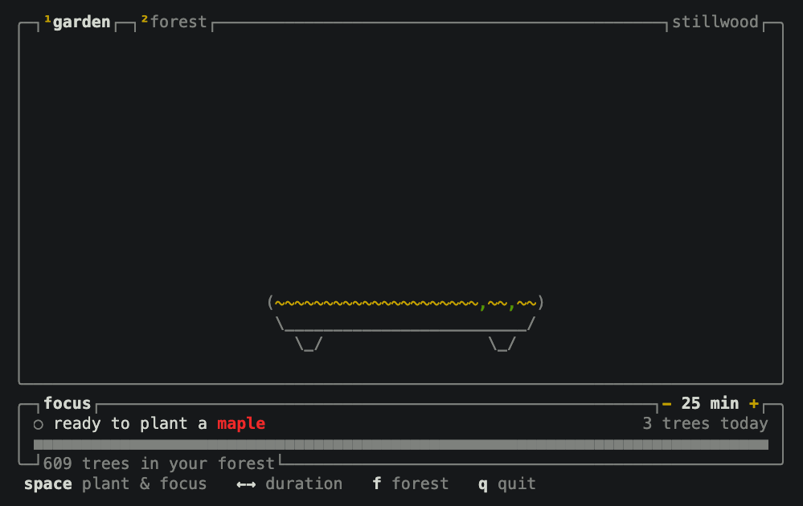
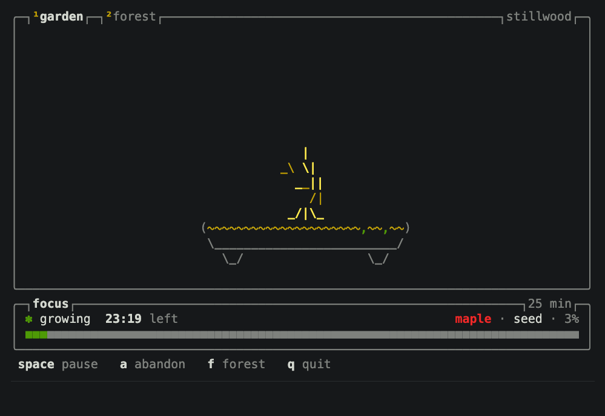
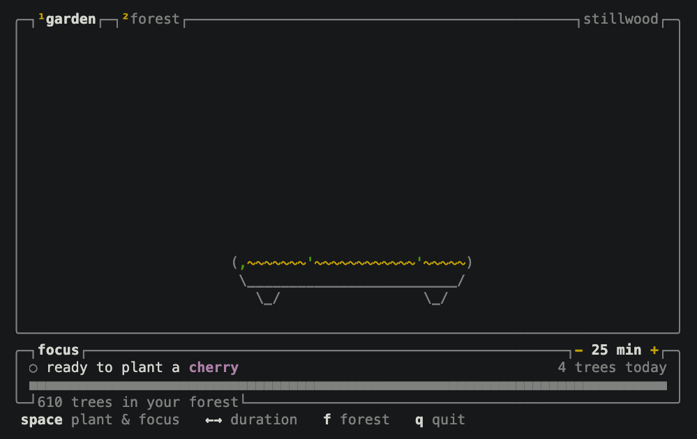
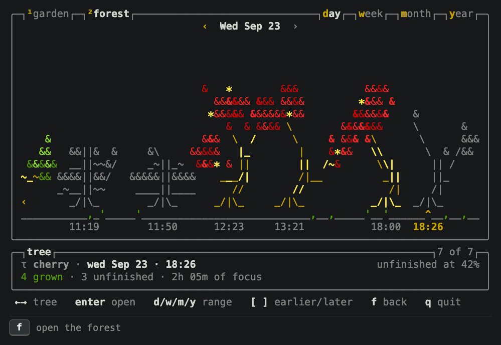
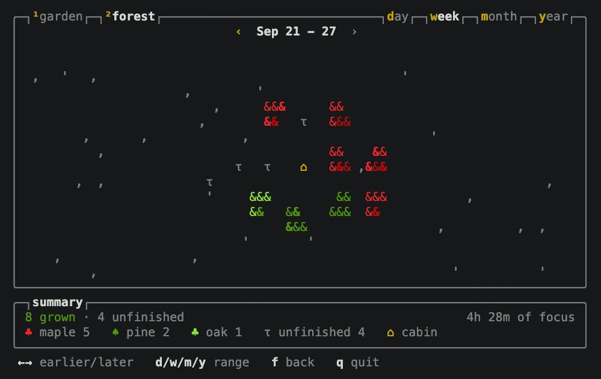
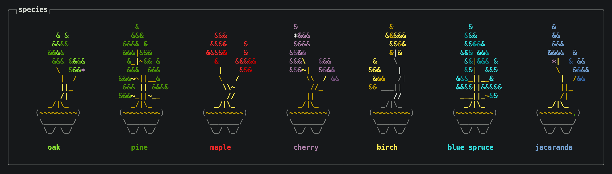

<p align="center">
  
</p>

<p align="center">
  <a href="https://github.com/Ahm3tJ4f/stillwood/actions/workflows/ci.yml"></a>
  <a href="https://github.com/Ahm3tJ4f/stillwood/releases/latest"></a>
  <a href="LICENSE"></a>
</p>

Stillwood is a focus timer for the terminal. When you start a session, a small ASCII tree grows.
When the session is complete, the tree goes into your forest.

## Install

macOS and Linux:

```sh
curl -fsSL https://raw.githubusercontent.com/Ahm3tJ4f/stillwood/main/install.sh | sh
```

Windows (PowerShell):

```powershell
irm https://raw.githubusercontent.com/Ahm3tJ4f/stillwood/main/install.ps1 | iex
```

With [Bun](https://bun.sh):

```sh
bunx stillwood
```

## Walkthrough

The GIFs show the real app. In them, time goes faster.

### 1. Plant a seed

Type `stillwood` in a terminal. Press `←` or `→` to set the length of the session. Press `space`
to plant the seed.



### 2. Focus

Work while the timer counts down. The tree grows during the session. When the time is done, the
tree blooms.



### 3. Stop the timer or end the session

Press `space` to stop the timer. Press `space` again to continue. Press `a` to end the session. A
tree from a session that you end stays small and gray.



### 4. Look at your forest

Press `f`. The forest opens on today, with your trees in a row. Press `←` and `→` to select a tree.
Press `enter` to see the tree grow again.



### 5. See the week, the month and the year

Press `w`, `m` or `y` to see the forest of the week, the month or the year from above. Press `←`
and `→` to go to an earlier or a later period.



## Trees



Each tree is one of seven species: oak, pine, maple, cherry, birch, blue spruce and jacaranda.
Each species has its own colors. Before you plant the seed, press `t` to select the next species,
or click the name of the species. If you do not select a species, Stillwood selects one at
random. A longer session grows a taller tree. If you end a session
before the time is done, the tree stays small and gray.

Stillwood uses only the 16 colors of your terminal theme, so it shows correctly in light and
dark themes.

## Keys

The bottom line of the screen always shows the keys that you can use.

| Screen                   | Keys                                                                                    |
| ------------------------ | --------------------------------------------------------------------------------------- |
| Garden, before the start | `space` plant the seed · `←` `→` set the length · `t` tree type · `f` forest · `q` quit |
| Garden, in a session     | `space` stop or continue the timer · `a` end the session · `f` forest                   |
| Forest, day              | `←` `→` select a tree · `enter` open the tree · `[` `]` earlier or later day            |
| Forest, week to year     | `←` `→` earlier or later week, month or year                                            |
| Forest, all              | `d` `w` `m` `y` day, week, month or year · `f` back to the garden                       |
| All screens              | `1` garden · `2` forest · `Ctrl+C` quit · `Ctrl+Z` suspend                              |

You can also click a tree, a tab or a key in a panel border.

## Options

| Option             | Function                                                                                      |
| ------------------ | --------------------------------------------------------------------------------------------- |
| `--minutes <n>`    | Set the length of the first session. The default is 25.                                       |
| `--species <id>`   | Always grow this species: `oak`, `pine`, `maple`, `cherry`, `birch`, `spruce` or `jacaranda`. |
| `--no-color`       | Show no colors. The `NO_COLOR` variable has the same effect.                                  |
| `--ascii`          | Use only ASCII characters, for fonts without box or tree symbols.                             |
| `--data-dir <dir>` | Keep the history in a different directory.                                                    |
| `-v`, `--version`  | Show the version.                                                                             |

## History

Stillwood keeps your trees in a JSON file:

| System  | File                                                  |
| ------- | ----------------------------------------------------- |
| macOS   | `~/Library/Application Support/stillwood/forest.json` |
| Linux   | `~/.local/share/stillwood/forest.json`                |
| Windows | `%APPDATA%\stillwood\forest.json`                     |

If the file is damaged, Stillwood keeps a copy of the file and starts a new history.

## Build from source

You must have [Bun](https://bun.sh) 1.3 or later.

```sh
git clone https://github.com/Ahm3tJ4f/stillwood.git
cd stillwood
bun install
bun start
```

| Command          | Function                                          |
| ---------------- | ------------------------------------------------- |
| `bun run check`  | Do a check of the format, the lint and the types. |
| `bun run build`  | Make a binary for this computer in `dist/`.       |
| `bun run assets` | Make the images of this README again.             |

To publish a release, do these steps:

1. Set the new version in `package.json`.
2. Push a tag with the same version, for example `v0.2.0`.

GitHub Actions then builds the binaries for macOS, Linux and Windows and publishes the release.

## Credits

The tree comes from an idea in [cbonsai](https://gitlab.com/jallbrit/cbonsai).

## License

[MIT](LICENSE)
